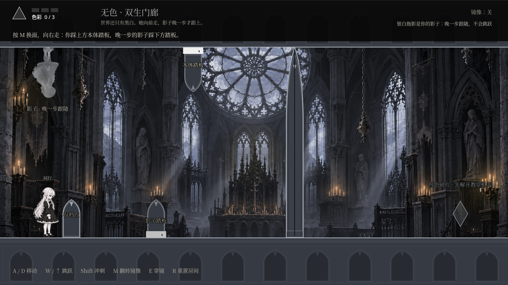
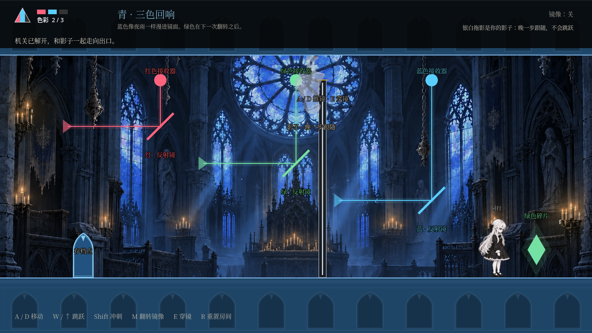

# 镜中同行

Godot 4.7.2 标准版的 2D 镜像解谜游戏。少女与晚半拍的分身走进同一座哥特教堂，通过分身配合、推镜传送和棱镜光路找回颜色。

## 运行

1. 使用 Godot 4.7.2 标准版导入 `project.godot`，等待素材导入后按 F5。
2. 输入名字并点击「踏入镜中」，在序章中按 Enter 或点击镜门进入游戏。
3. 已有存档可在标题画面选择「继续旅程」。

游戏使用 GDScript，不需要 .NET 或 C# 构建。仓库保留的 Godot-MCP C# 编辑器插件默认关闭；需要该可选插件时，可自行使用 .NET 版编辑器并启用它。

画面基准为 1920 × 1080，拉伸模式为 `canvas_items`。四关恢复单屏布局。

## 操作

| 按键 | 功能 |
| --- | --- |
| A / D 或方向键 | 移动；贴近立镜时推动镜面 |
| W / ↑ | 跳跃 |
| S / ↓ | 蹲下 |
| Shift | 冲刺；推动镜面时保持稳定推行姿态 |
| M | 上下翻转画面与重力；光路关中同时转动最近一面反射镜 |
| E | 靠近立镜时穿到镜面的另一侧 |
| R | 重置当前房间 |

## 三种玩法与四个世界

| 世界 | 玩法 | 目标 |
| --- | --- | --- |
| 灰 · 双生门廊 | 分身配合 | 翻转后本体与分身同时踩住上下踏板，取得红色 |
| 红 · 推镜廊 | 推镜传送 | 把镜面推入金色刻度，实际穿镜后取得蓝色 |
| 蓝 · 三色回响 | 棱镜光路 | 调整三面反射镜并移动遮光立镜，让三色同时抵达，取得绿色 |
| 绿 · 最后的同行 | 三者组合 | 先完成双板配合，再穿镜并接通三色光路，走向出口 |

分身延迟 0.42 秒继承水平移动，使用相反重力，不共享跳跃。上下踏板分别标明「本体」和「影子」；双板必须同时被对应角色压住，门才会打开。

镜面自己的 x 是水平传送轴，出口位置遵循 `Vector2(2 * slab.x - entry.x, entry.y)`。出口被真实碰撞体挡住时会拒绝传送，并显示正向可读的提示。

光束沿实际反射线路抵达对应接收器。M 只转动角色附近的一面镜子；推动立镜会改变遮挡关系。两色接通时显示 2/3 的接近成功反馈，光路被重新遮断后门和收集物会再次锁住。光路状态与左上角的颜色收集进度相互独立。

世界按灰→红→蓝→绿推进，只收集红、蓝、绿三个颜色，进度最多 3/3。关卡提示、镜面提示、接收器名称和角色名字在画面翻转后仍保持正向可读。

## 场景

四个区域使用同一教堂构图的独立背景图，分别表现月光灰、血玻璃红、夜祷蓝和苔痕绿。背景已去除画死的人物、分身、踏板、门和平台，这些可交互元素全部由游戏中的真实节点显示。

[灰色实机画面](docs/level_01.png) · [红色实机画面](docs/level_red.png) · [蓝色实机画面](docs/level_blue.png) · [绿色实机画面](docs/level_green.png) · [翻转画面](docs/level_01_mirror.png)





## 存档与验证

入口存档点、颜色收集和世界推进会写入 `user://mirror_save.cfg`。重生会清空穿镜和光路状态。旧版滚动关卡存档会保留名字、颜色和世界进度，从对应新房间的入口恢复，避免沿用越界坐标。

使用标准版 Godot 在项目根目录执行：

```sh
godot --headless --editor --import --quit
XDG_DATA_HOME="$(mktemp -d)" godot --headless --fixed-fps 60 --path . --script res://tests/mirror_mechanics.gd
```

测试覆盖序章进入、分身延迟、镜像重力、安全重定位、翻转文字、推行姿态、真实传送与阻挡、光束反射与遮挡、四关实际输入通关、三色顺序以及旧存档迁移。背景、字体与界面还通过实际 OpenGL 渲染截图检查。
