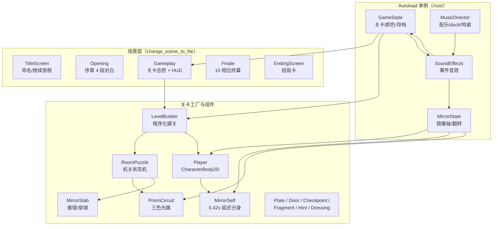
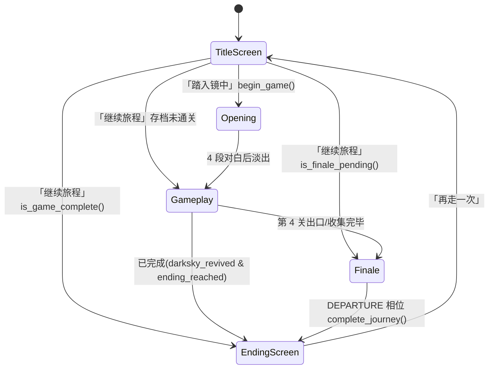

# 镜尽余色 · 项目框架说明

> 面向接手/扩展本项目的开发者。本文描述 **当前仓库（main 分支）** 的实际结构，所有结论都对应到 `文件:行号`，可直接跳转核对。
>
> 配套文档：[README](../README.md)（玩法与素材说明）、[剧情稿](story.md)、[MCP 测试报告](mcp-test.md)（Godot-MCP 工具链实测）。
>
> 统计口径（2026-10-25 优化后）：GDScript 32 个文件 3616 行（含空行，`scripts/`）；测试 3 个文件 906 行；着色器 8 个文件 293 行；场景 6 个 `.tscn`。

---

## 1. 项目概览

| 项目 | 内容 | 依据 |
| --- | --- | --- |
| 类型 | 2D 横版镜像解谜 + 叙事（四世界、三种玩法、终幕追逐与结局） | [README](../README.md) |
| 引擎 | Godot **4.7.2 标准版**（GDScript，不需要 .NET） | [README](../README.md) 第 9、15 行 |
| 主场景 | `res://scenes/ui/title_screen.tscn` | `project.godot:14` |
| 分辨率 | 1920×1080，`canvas_items` 拉伸、`expand` 宽高比 | `project.godot:29-34` |
| 渲染 | `mobile` 渲染器；Windows 走 `d3d12` | `project.godot:100-103` |
| UI 主题 | `res://assets/ui/ui_theme.tres` | `project.godot:44-46` |
| 存档 | `user://mirror_save.cfg`，ConfigFile，**第 7 版** | `scripts/game_state.gd:11-12` |
| 入口脚本 | 标题 → 序章 → 四关循环 → 终幕 → 结局 | `scripts/title_screen.gd:40-45` 等 |

**规模现状**（`scripts/` 内共 32 个 `.gd`）：

| 模块 | 文件数 | 行数 | 说明 |
| --- | --- | --- | --- |
| 游戏脚本 | 32 | 3616 | 4 个 autoload + 5 个场景控制器 + 玩法组件 + `palette.gd` 常量 |
| 测试 | 3 | 906 | `mirror_mechanics.gd` 753 行是主测试 |
| 着色器 | 8 | 293 | 7 个 `.gdshader` + 1 个共享 `.gdshaderinc` |
| 场景 | 6 | — | `gameplay`/`player` 有真实节点树，`finale` 几乎全运行时生成 |
| 工具 | 5 个 Python | — | `tools/` 离线美术/音频流水线 |

> 注意：本地工作区的 `project.godot:15` 目前为 `PackedStringArray("4.7", "C#", "Mobile")`（未提交改动，HEAD 中无 `C#`），`project.godot:36-38` 还保留 `[dotnet]` 段——这是启用 Godot-MCP C# 插件留下的痕迹，GDScript 运行不依赖它。见 §13 R8。

---

## 2. 运行时架构

### 2.1 分层



- **状态层**：4 个 autoload 承担跨场景状态（镜像、进度、音效、音乐），无全局事件总线。
- **场景层**：每个场景自带控制器脚本，用 `GameState` 的内存字段 + 存档在场景间传递状态（`change_scene_to_file` 不传参）。
- **关卡层**：`gameplay.tscn` 只提供骨架，房间内容全部由 `LevelBuilder` 在运行时 `new()` + `set_script()` 生成（唯一例外是 Player 实例）。
- **表现层**：全屏镜像由 `ScreenMirror`（挂在 Player 下的 CanvasLayer 100）用 BackBufferCopy + shader 实现；文字类 UI 放在更高 layer 保持正向。

### 2.2 Autoload 清单（加载顺序 `project.godot:22-27`）

| 单例 | 脚本 | 职责 | 关键 API / 信号 |
| --- | --- | --- | --- |
| `MirrorState` | `scripts/mirror_state.gd`（52 行） | 唯一的世界镜像轴与翻转态，物理/HUD/渲染共用；M 键全局处理 | `mirror_changed(bool)`、`axis_changed(float)`、`reset_requested`；`TOGGLE_COOLDOWN_MS=180`(:8)、`axis_y=540`(:9)、`reflect_point()`(:19-20)、`toggle()`(:27-32)、`reset()`(:46-48) |
| `GameState` | `scripts/game_state.gd`（263 行） | 关卡数据表、玩家名、颜色位掩码、存档、终幕/光路状态 | `changed`、`checkpoint_saved(Vector2)`(:6-7)；`SAVE_VERSION=7`(:11)；`LEVELS` 四关表(:16-81)；`collect_current_color()`(:127)、`advance_level()`(:135)、`save_checkpoint()`(:146)、`offer_colors()`(:163)、`revive_darksky()`(:174)、`load_from_disk()`(:192)、`_save_game()`(:224)、光路状态(:241-256) |
| `SoundEffects` | `scripts/sound_effects.gd`（126 行） | 纯被动监听既有信号播放 4 声部限音效，不改玩法规则 | `effect_played(StringName)`；`MAX_VOICES=4`(:5)；6 段 CUES(:6-13)；SFX 总线(:43)；按 `GameState.changed` 新增颜色放音(:77-85)；`node_added` 按脚本资源身份绑定 slab/巨镜(:87-106) |
| `MusicDirector` | `scripts/music_director.gd`（175 行） | 三首配乐、双播放器交叉淡化、循环、音效 duck、音乐鸣谢 | `TRACKS`(:5-9)、`LOOP_CROSSFADE=3.0`(:10)；按 `current_scene`/`finale.phase` 选曲(:55-100)；`transition_to()`(:112-139)；`_on_effect_played` duck(:141-151) |

依赖方向：`SoundEffects → GameState/MirrorState`，`MusicDirector → SoundEffects`，**无循环依赖**；MusicDirector 已用 `get_node_or_null` 防御缺失的 `/root/SoundEffects`（R6 ✅）。

---

## 3. 目录结构与职责

| 目录/文件 | 职责 |
| --- | --- |
| `project.godot` | 引擎/输入/autoload/显示配置；`[editor_plugins] enabled=[]`（:40-42）默认关闭 MCP 插件 |
| `scenes/` | 6 个场景：`ui/title_screen`、`opening/opening`、`gameplay/gameplay`、`player/player`、`finale/finale`、`ui/ending_screen` |
| `scripts/` | 全部游戏逻辑（32 个 `.gd`），详见 §12 脚本索引 |
| `shaders/` | 镜像/背景/镜门/追逐/阴影/区域薄雾/去琥珀色；`rgb_palette.gdshaderinc` 为共享 include |
| `assets/` | `audio/`(3 ogg 音乐 + 6 wav 音效 + bus layout + 署名)、`backgrounds/`(28)、`characters/`(hero、darksky 的 AtlasTexture 帧)、`props/`、`ui/` |
| `tests/` | 3 个 headless 测试，见 §13 |
| `tools/` | 离线流水线：`build_hero_sheet.py`、`build_hero_animations.py`、`build_darksky_animations.py`、`build_sfx.py`、`prepare_music.py` |
| `docs/` | `story.md` 剧情稿、18 张验证截图；`docs/.gdignore` 使截图不参与导入 |
| `addons/godot_mcp/` | 外部 **Godot-MCP** C# 编辑器插件（Editor/Runtime/Icons + `plugin.cfg` + NuGet 依赖）；默认关闭，属开发工具链，不是游戏逻辑 |
| `.claude/skills/` | 26 份该插件的客户端用法文档（`godot-cli`、`rql-*`、`script-*`、`screenshot-*`、`runtime-errors-*`、`reflection-*` 等） |
| `.godot/` | 引擎缓存与 `mcp-server/` 本地 MCP 服务可执行文件（不入库） |
| `.env.example` / `.env` | Godot-MCP 插件连接配置模板/本地实例；`.env` 已被 `.gitignore` 忽略（见 §11.3） |

---

## 4. 场景流转与场景树

### 4.1 流转



- 标题：`_begin()` → `GameState.begin_game()`（清档）→ opening；`_continue()` → `load_from_disk()` 后按 `is_finale_pending()` / `is_game_complete()` 三分支（`scripts/title_screen.gd:27-45`）。
- 序章：4 段 `STORY_LINES`（`scripts/opening.gd:5-10`）；进入时禁用镜像输入（:36-40），先等 0.7s 吞掉切场景残余输入（:64-65），最后淡出进 gameplay（:104-116）。
- 关卡：`gameplay.gd:39-45` 在建关前先判断终幕/完成分支；否则 `LevelBuilder.build()` + spawn/checkpoint + 创建分身 + 绑定 `goal.collected`（:47-78）；收集/出口后 `advance_level()` 再 `load_level()`（:105-106）。R 键直接整关重建（:123-126）。
- 终幕：10 相位 `THRESHOLD→CROSSOVER→BETRAYAL→CHASE→SHATTER→CONFESSION→FUSION→REUNION→EMBRACE→DEPARTURE`（`scripts/finale.gd:3`）；`DEPARTURE` 末尾 `complete_journey()` 后切结局（:535-536）；续玩时 `_ready` 按 `has_offered_colors()` 直接把玩家放到碎镜之后（:85-93）。
- 结局：显示文案 + 「再走一次」回标题（`scripts/ending_screen.gd:22-23`）。

### 4.2 场景树

| 场景 | 节点树要点 |
| --- | --- |
| `gameplay.tscn` | `Gameplay(Node2D, gameplay.gd)` → `Backdrop(CanvasLayer -10)/Base(ColorRect)`、`LevelRoot`（运行时填充）、`Camera`、`LevelBuilder(level_builder.gd)`、`Player(实例)`、`HUD(CanvasLayer 110, mirror_hud.gd)`、`CollectionCG(CanvasLayer 115, collection_cg.gd, process_mode=ALWAYS)` |
| `player.tscn` | `Player(CharacterBody2D, groups=["player"], player.gd)` → `Sprite`、`Collision`(胶囊)、`ScreenMirror(CanvasLayer 100, screen_mirror.gd)` + `BackBufferCopy` + `Overlay`、`NameTagLayer(CanvasLayer 105, name_tag.gd)` |
| `title_screen.tscn` | `Control`：Backdrop(mirror_hands.png)、Title/Subtitle/Story、NameEdit、Begin/Continue、ColorProgress |
| `opening.tscn` | `Control`：Backdrop、Photo 与 Gate 两张同图 Sprite（Gate 用 mirror_gate.gdshader 制造玻璃扰动）、Caption、Fade |
| `finale.tscn` | 仅 `Node2D + finale.gd`，世界/演员/UI 全在 `_ready` 生成 |
| `ending_screen.tscn` | `Control`：Backdrop(ending_together.png)、Title/Subtitle/Story、Restart、ColorProgress |

**CanvasLayer 约定（保证画面翻转后文字仍正向）**：世界/精灵 ≤ 0 → `ScreenMirror=100` → `NameTag=105` → `readable_hint=108` → `HUD=110` → `CollectionCG=115` → 音乐鸣谢 `130`。

---

## 5. 核心玩法系统

| 系统 | 实现 | 关键规则（代码依据） |
| --- | --- | --- |
| 镜像翻转与重力 | `mirror_state.gd`、`player.gd:87-94`、`mirror_self.gd:71-77` | M 翻转；轴 `axis_y=540`；翻转的是重力方向而非速度；180ms 冷却；翻转后 deferred 遍历 `mirror_actors` 做安全重定位 |
| 分身（0.42s 延迟） | `mirror_self.gd` | `FOLLOW_DELAY=0.42`(:7)；记录本体 `velocity.x` 历史并按 0.42s 前的值逼近(:83-87)；相反重力、不共享跳跃；轴反射出生(:58-69)；残影 2 层 + 轨迹 4 点 |
| 安全重定位 | `mirror_safety.gd` | 用真实胶囊形状 `intersect_shape`（含 0.1 皮肤）查询，再按 原地→沿 y→轴反射→横向 搜索可行点(:5-47) |
| 推镜与穿镜 | `mirror_slab.gd`、`level_builder.gd:214-223` | E 在 \|Δx\|≤180 触发(:60)；出口 `Vector2(2*slab.x-entry.x, entry.y)`(:54-55)；目标被真实碰撞体挡住则拒绝并提示(:64-69)；推动上限 120/s，撞角色/地形即停(:77-100) |
| 双人穿镜 | `level_builder.gd:238-252` | 后期关卡给 slab 设 meta `carries_echo`，`transported` 后调用 `reset_echo` 把分身一起带到另一侧 |
| 三色光路 | `prism_circuit.gd` | 3 面反射镜 + 3 接收器；M 只转角色附近 185px 内最近一面(:57-64)；每通道最多 6 次反弹，用 `Geometry2D` 求交，镜子/立镜/接收器/墙按距离取最近命中(:91-146)；立镜移动可物理遮断光路；`channel_mask` 写回 `GameState.set_light_channels`(:147-152) |
| 影子封印 | `level_builder.gd:225-247` + `prism_circuit.gd:41-48` | 3 枚踏板 x=490/990/1370，上/下/上；`player_group="mirror_self"`、锁存；只有影子能点亮（本体无效），亮起后光源闸打开 |
| 机关状态机 | `room_puzzle.gd` + `level_builder.gd:97-114` | `steps` 字典数组，5 种 `kind`：`plate`/`slab`/`prism`/`transit_prism`/`paired_prism(&transit_)`，判据见 :61-79；稳定 **0.08s** 才开门(:80-86)；光路中断会回退已解步数并关门(:52-58,87-89) |
| 颜色收集与 CG | `color_fragment.gd`、`collection_cg.gd`、`gameplay.gd:80-106` | 只有 `player` 组能拾取；出口变体 `is_exit` 只开门不给色；CG 暂停整棵树（layer 115、`PROCESS_MODE_ALWAYS`）、最短观看 1.8s；先存档再放 CG，中断后续看同段 |
| 存档 | `game_state.gd:192-231`、`checkpoint.gd` | ConfigFile v7，10 个字段；存档点触发时把 `RoomPuzzle.solved_steps` 作为 `stage` 一起写；老版本按 v4/v6/v7 规则迁移 |
| 调试键 | `gameplay.gd:108-121`、`finale.gd:541-543` | P 仅 debug build：直接获得本关颜色/碎镜跳段，走真实 CG+存档路径，按住不连发；R 重置本关 |

### 5.1 镜像三层的实现要点

1. **物理层**：`gravity_sign` 与 `up_direction` 取反，碰撞体/精灵偏移补偿（`player.gd:87-94`、`mirror_self.gd:71-77`）。
2. **表现层**：`screen_mirror.gd` 在 CanvasLayer 100 上用 `BackBufferCopy(COPY_MODE_VIEWPORT)` 抓屏，shader 对 `uv.y` 做 `mix(uv.y, 2*axis_y-uv.y, mirrored)`；轴由世界坐标经相机变换投影到屏幕（`shaders/screen_mirror.gdshader:7-14`）。
3. **文字层**：HUD/NameTag/readable_hint/CG 放在 >100 的 layer；`readable_hint.gd` 每帧把世界锚点投影回屏幕，翻转时文字仍正向。

---

## 6. LevelBuilder 构建管线

`LevelBuilder.build(index, parent)`（`scripts/level_builder.gd:17-95`）：

1. 取 `GameState.get_level(index)` 调色板 → 清空旧节点 → `end_light_puzzle()`（:18-22）。
2. 地板/天花板各一条 1920 宽 run（:23,206-212）。
3. `match index` 生成机关 steps（:25-78）——**关卡结构是代码内硬编码规格，不是数据文件**。
4. 左右边墙（:79-80）→ `RegionDressing` 区域装饰（:81,370-380）→ 初始存档点 → 颜色碎片/出口（:83,148-165）。
5. 建 `RoomPuzzle` 节点注入 `steps` + `goal`（:84-89）→ 关卡专属额外存档点（:90-94）。
6. 返回 `{spawn:(180,900), goal, width:1920}`（:95）。

生成原语：`_step()`（踏板组+门）、`_plate()`、`_slab()`、`_light_step()`、`_mirror_target()`、`_checkpoint()`、`_fragment()`；哥特外观全部由 `_paint()` 的 draw 回调 + `_arch_visual/_rose_window/_flying_buttress/_rect_visual` 自绘（:273-369），不依赖切图。

| 关卡 | 玩法组合 | 关键坐标 |
| --- | --- | --- |
| 0 灰 · 双生门廊 | 3 组双板接力 + 3 道门（教学标签） | 门 x=720/1190/1660；存档 x=270/1240 |
| 1 红 · 推镜廊 | 双板 + 立镜 + 两次校准穿镜 | 接引 1230/810、镜印 1080/940、存档 740/1300 |
| 2 蓝 · 三色回响 | 立镜 + 三色光路 + 出口双板 | 光路门 1510、印章 x=490/990/1370 |
| 3 绿 · 最后的同行 | 双板 + 同渡穿镜 + 三色光路 + 追加双板 | 出口在 x=1740（`WORLD_WIDTH-180`） |

---

## 7. 信号与事件流

| 事件链 | 路径 |
| --- | --- |
| 翻转链 | `MirrorState.mirror_changed` → Player / MirrorSelf / MirrorPlate / PrismCircuit / ScreenMirror / MirrorHUD / SoundEffects；随后 deferred 重定位 |
| 存档链 | `checkpoint.body_entered` → `GameState.save_checkpoint()` → 写 cfg + `checkpoint_saved` → gameplay 显示「已存档」toast |
| 颜色链 | `color_fragment.collected` → `gameplay._on_color_found()` → `GameState.collect_current_color()`（写档+`changed`）→ ColorProgress 重绘 + 晶体音效 → CG `finished` → `advance_level()` → `load_level()` |
| 穿镜链 | `mirror_slab.transported` → SoundEffects 播放 `mirror_pass` + `level_builder._carry_echo` |
| 碎镜链 | `final_mirror.shattered` → SoundEffects 播放 `mirror_shatter` → MusicDirector duck / 淡出 |
| 音乐链 | MusicDirector 每帧轮询 `current_scene` 与 `finale.phase`（无事件总线） |

构造特点：**信号 + 每帧轮询混合**。门/机关由 `RoomPuzzle._physics_process` 轮询踏板与光路状态（不是信号驱动），因此有 0.08s 稳定窗口；`GameState` 的位掩码是颜色/光路的唯一事实来源。

---

## 8. 渲染与着色器

| 着色器 | 用途 | 使用位置 |
| --- | --- | --- |
| `screen_mirror.gdshader` | 全屏抓屏后沿屏幕轴镜像 | `screen_mirror.gd` |
| `level_backdrop.gdshader`（128 行，最大） | 程序化哥特背景：fbm 石材/柱廊/玫瑰窗光束/尘埃/雾/暗角/饱和度，并有 `use_scene_texture` 分支画四张 `church_*.png` | `gameplay.gd:49-60` |
| `mirror_gate.gdshader` | 序章镜门：拱形遮罩 + 正弦 ripple 只扰动玻璃区 | `opening.tscn` |
| `chase_spectrum.gdshader` | 追逐走廊按 `color_mask` 保留颜色家族 + 三束彩光 + 去饱和 | `chase_backdrop.gd` |
| `shadow_tint.gdshader` | 分身/终幕影子的烟尘质感（alpha ≤0.62） | `mirror_self.gd`、`finale.gd` |
| `restricted_art.gdshader` | 插画去琥珀/单色化 + 顶点染色 | 标题/结局/序章/收集 CG/立镜/巨镜 |
| `aisle_mist.gdshader` | 蓝色区薄雾 | `region_dressing.gd` |
| `rgb_palette.gdshaderinc` | 共享 include：`without_amber()` 把旧插画琥珀色降灰 | 被上述 4 个 shader include |

音频总线：Master 0dB / SFX −8dB / Music −13dB（`assets/audio/default_bus_layout.tres`）。人物与道具用 AtlasTexture 裁切原图，不重存切图（`hero_frames.tres`、`darksky_frames.tres`、`props/*.tres`）。

---

## 9. 输入映射（`project.godot:48-98`）

| 动作 | 键位 | 处理位置 |
| --- | --- | --- |
| `move_left` / `move_right` | A/← · D/→ | `player.gd` |
| `jump` | W/↑ | `player.gd` |
| `crouch` | S/↓ | `player.gd` |
| `sprint` | Shift | `player.gd` |
| `mirror` | M | `mirror_state.gd:22-25`（全局） |
| `interact` | E | `mirror_slab.gd:57-62` |
| `restart_room` | R | `gameplay.gd:123-126`、`finale.gd:544-546` |
| `developer_skip` | P（仅 debug build） | `gameplay.gd:108-121`、`finale.gd:541-543` |
| 终幕对白 | `ui_accept`（Enter/空格） | `finale.gd` |

> `interact/P/R/M` 用 `physical_keycode`，移动/跳跃类用 `keycode`，非 QWERTY 布局下行为不同（见 §13 R7）。

---

## 10. 数据与存档

- **颜色**：`collected_mask` 位 0/1/2 = 红/蓝/绿（关卡顺序红→蓝→绿，`game_state.gd:22,38,54`）。第 4 关只有出口，`collect_current_color()` 会拒绝（:127-133）。RGB 色值统一来自 `scripts/palette.gd`。
- **光路**：独立于颜色进度，`light_puzzle_active + light_channels`（3 bit），只有 `mask==7` 才开门（:241-256）；通道 bit 顺序为红/绿/蓝，同样来自 `palette.gd` 的 `CHANNEL_COLORS`。
- **存档字段（v7）**：`player_name`、`current_level`、`collected_mask`、`checkpoint_stage/level/position`、`has_checkpoint`、`ending_reached`、`offered_mask`、`darksky_revived`（`game_state.gd:224-231`，共 10 项）。
- **迁移规则**：v<4 丢弃 checkpoint；v<6 清早期 checkpoint、不认 `offered_mask`；v<7 蓝绿关 checkpoint 作废；旧完成档直接进入新版团聚（:198-219）。
- **赠色语义**：`offer_colors()` 把 `collected_mask` 移到 `offered_mask` 并清空库存，防止重复花费；`complete_journey()` 必须 `darksky_revived`（:163-187）。
- **存档点**：第 0 关 x=270/1240，第 1 关 x=740/1300（`level_builder.gd:90-94`）；重生会清空穿镜/封印/光路状态。

---

## 11. 测试与工具链

### 11.1 运行

```sh
godot --headless --editor --import --quit
XDG_DATA_HOME="$(mktemp -d)" godot --headless --fixed-fps 60 --path . --script res://tests/mirror_mechanics.gd
XDG_DATA_HOME="$(mktemp -d)" godot --headless --audio-driver Dummy --path . --script res://tests/audio_mix.gd
XDG_DATA_HOME="$(mktemp -d)" godot --headless --audio-driver Dummy --path . --script res://tests/music_playback.gd
```

音频/音乐测试按真实时间运行，**不要加 `--fixed-fps`**。Windows 下 `XDG_DATA_HOME` 语义不同，建议用 `APPDATA`/临时 `--user-data-dir` 或项目外的 `user://` 隔离目录，避免污染真实存档。

### 11.2 测试体系

| 文件 | 行数 | 覆盖 |
| --- | --- | --- |
| `tests/mirror_mechanics.gd` | 753 | 标题/序章、延迟与反重力、推镜姿态、真实输入通关、镜印与失败传送、光路遮挡/重新配合、影子封印、同渡穿镜、三色顺序、CG 暂停与续看、追逐重试、碎镜多边形、赠色/复活/拥抱、存档 v4/v6/v7 迁移、背景/绘制预算、P 跳关 |
| `tests/audio_mix.gd` | 66 | 6 段音效实际发声、经 SFX 总线压低、四段叠加不削波（AudioEffectCapture 实测） |
| `tests/music_playback.gd` | 87 | 切曲/交叉淡化/循环、CG 暂停续播、碎镜让位、音乐+音效总输出上限、鸣谢按钮 |

三者均为 `extends SceneTree` 的自建断言（`check()` 累加失败、末尾 `quit(1)`），不是 GUT/gdUnit。

### 11.3 工具与 MCP

- `tools/*.py`：从原始插画切帧生成 SpriteFrames/AtlasTexture 元数据、NumPy 确定性合成音效、ffmpeg 裁剪/响度归一配乐并校验 SHA-256。属离线流水线，运行结果已入库，正常开发不需要执行。
- **Godot-MCP**：`addons/godot_mcp` 是可选 C# 编辑器插件（默认关闭）；本地 `gamedev-mcp-server` 9.2.17 监听 `http://localhost:26475/mcp`，DSH 侧配置在 `~/.dsh/profiles/desktop/cordis.patch.yml` 第 35-46 行的 `mcp-godot` 条目。`.claude/skills/` 的 26 份文档描述其工具用法（已被 `.gitignore:6` 忽略，编辑器中重新生成）；注意 0.33.0 插件实际没有 `ping` 工具，健康检查用 `rql-schema`。
- **端口已修复（2026-10-25）**：插件按项目身份默认派生端口 **23156**，与常驻服务/DSH 的 **26475** 不一致。仓库现提供 `.env.example`（复制为 `.env`，已被 gitignore）写入 `GODOT_MCP_HOST=http://localhost:26475`、`GODOT_MCP_CONNECTION_MODE=Custom`、`GODOT_MCP_AUTH_OPTION=none`；插件启动时自动读取，编辑器无需任何环境变量即可连上 26475。实测 `tools/list` 返回 15 个引擎工具，`rql-schema` 调用 `isError=false`；未连接时 `tools/list`/`resources/list` 为空，引擎工具调用会重试 10 次后返回错误。
- 完整测试矩阵、证据与修复/复测步骤（含 curl 复现、临时启用插件的可复现命令）见 **[MCP 测试报告](mcp-test.md)** 的 §11。

---

## 12. 脚本索引（32 个）

| 脚本 | 职责 | 关键依赖 |
| --- | --- | --- |
| `mirror_state.gd` | 全局镜像轴/翻转/重置（autoload） | 被全部玩法/HUD/渲染订阅 |
| `game_state.gd` | 关卡表/颜色/存档/终幕状态（autoload） | ConfigFile `user://mirror_save.cfg`、`palette.gd` |
| `palette.gd` | RGB 常量单一来源：`JOURNEY_COLORS`（红蓝绿）、`CHANNEL_COLORS`（红绿蓝）与名称 | 被 game_state / prism_circuit / level_builder / chase_backdrop / finale 引用 |
| `sound_effects.gd` | 六段事件音效、4 声部限音（autoload） | `GameState.changed`、`MirrorState`、`node_added` |
| `music_director.gd` | 三轨配乐、交叉淡化、duck、鸣谢（autoload） | `/root/SoundEffects`（防御式获取）、`finale.phase` |
| `title_screen.gd` | 标题/命名/继续旅程分支 | `GameState` |
| `opening.gd` | 序章 4 段对白 + 镜门 ripple + 淡出 | `mirror_gate.gdshader`、`mirror_hands.png` |
| `gameplay.gd` | 关卡总控：建关/spawn/checkpoint/CG/P/R/camera | `LevelBuilder`、`RoomPuzzle`、`GameState` |
| `level_builder.gd` | 四关程序化工厂（节点/碰撞/自绘/机关/存档点） | 10 个组件脚本 + `GameState.LEVELS` |
| `room_puzzle.gd` | 机关状态机（5 种 kind、0.08s 稳定开门） | plates/door/slab/circuit、`MirrorState.reset_requested` |
| `mirror_plate.gd` | 踏板：按 `player_group` 压住/锁存 | `MirrorState`、groups `player`/`mirror_self` |
| `puzzle_door.gd` | 门：deferred 碰撞开关 + 淡出 | `room_puzzle` |
| `mirror_slab.gd` | 立镜推动、E 传送、失败提示、双人穿镜 | `MirrorSafety`、`transported` 信号 |
| `prism_circuit.gd` | 三色光路几何反射/遮挡/接收/封印光源 | `MirrorState`、slab 组、`GameState` 光路状态 |
| `mirror_self.gd` | 分身：0.42s 延迟、反重力、残影、越界本体重生 | `source(player)`、`MirrorState` |
| `mirror_safety.gd` | static 胶囊级安全查询/重定位 | 被 player/mirror_self/slab 调用 |
| `hero_animation.gd` | static 动画姿态归一与步频 | player/mirror_self/finale |
| `player.gd` | 主角移动/跳跃/蹲/冲刺/推/动画/重生 | `MirrorState`、`MirrorSafety`、`HeroAnimation` |
| `screen_mirror.gd` | 全屏镜像呈现（BackBufferCopy + shader） | `MirrorState`、`screen_mirror.gdshader` |
| `name_tag.gd` | 跟随本体、翻转后重投影的名字牌 | `MirrorState`、`GameState.player_name` |
| `readable_hint.gd` | 世界锚点文字保持正向（layer 108） | `MirrorState.axis_y` |
| `mirror_hud.gd` | 右上镜像开关状态 | `MirrorState` |
| `color_progress.gd` | 左上三色棱镜进度/「已赠予」 | `GameState.changed` |
| `collection_cg.gd` | 拾色 CG、暂停树、1.8s 最短观看 | layer 115、`tree.paused` |
| `color_fragment.gd` | 颜色/出口拾取 Area2D + 自绘 | `gameplay._on_color_found` |
| `checkpoint.gd` | 存档点：写档并带机关 stage | `GameState.save_checkpoint` |
| `final_mirror.gd` | 终幕巨镜/贴掌动画/纹理碎片 | `gothic_mirror.png`、`shattered` |
| `chase_backdrop.gd` | 追逐走廊铺路 + 三层视差 + 去饱和 | `chase_spectrum.gdshader`、`GameState` masks |
| `finale.gd` | 终幕 10 相位导演（对白/CG/追逐/赠色/拥抱/离场） | `player.tscn`、`final_mirror`、`chase_backdrop` |
| `region_dressing.gd` | 四区装饰差异（链条/帷幔/雨/苔蔓墓碑） | 调色板、`aisle_mist.gdshader` |
| `music_credits.gd` | 标题/结局音乐鸣谢模态（运行时注入） | `MusicDirector` |
| `ending_screen.gd` | 结局卡 + 重新开始 | `GameState.player_name` |

---

## 13. 已知技术债与风险

> 状态标记：✅ = 2026-10-25 已修复；◐ = 部分处理；❌ = 保留待办。本轮回归测试：mirror_mechanics **429** / audio_mix **13** / music_playback **18** checks，0 failures（mirror 的断言数随场景 Label 数量浮动，删除 HUD 教学文案后由 430 变为 429）。

| # | 问题 | 证据 | 状态 / 建议 |
| --- | --- | --- | --- |
| R1 ✅ | 5 个废弃脚本共 161 行曾无任何引用 | `level_goal.gd`、`hazard.gd`、`fall_reset.gd`、`mirror_gate.gd`、`mirror_platform.gd` | 已删除脚本与 `.uid`；`mirror_gate.gdshader` 保留（序章仍在用） |
| R2 ✅ | 旧相位踏板残留属性/信号 | 曾见 `mirror_plate.requires_mirror/phase_independent/activated`、`puzzle_door.opened` | 已清理；`mirror_plate.gd` 从 47 行减到 31 行 |
| R3 ✅ | `GameState.completed_levels` 写/存但不读 | 曾见 `game_state.gd:84,140,229` | 已删除字段与存档键；旧存档多余键自动忽略，向后兼容 |
| R4 ✅ | 颜色通道序二义：关卡序红/蓝/绿，光路序红/绿/蓝 | `game_state.gd:22,38,54`、曾见 `prism_circuit.gd:5`、`chase_backdrop.gd:66` | 已收敛到 `scripts/palette.gd` 的 `JOURNEY_COLORS` / `CHANNEL_COLORS` |
| R5 ❌ | README 世界名「灰/红/蓝/绿」与代码「无色/赤/青/翠」不一致 | `README:35-38` vs `game_state.gd:18,34,50,66` | 未统一；代码名即游戏内 HUD 文案，优先保留 |
| R6 ✅ | autoload 隐式加载顺序：MusicDirector 直接取 `/root/SoundEffects` | `music_director.gd:47-51` | 已改 `get_node_or_null` + `push_warning` |
| R7 ❌ | 输入映射混用 `keycode` / `physical_keycode` | `project.godot:52,57,63,69,75,80,86,91,96` | 未改（涉及按键方案，需产品确认） |
| R8 ❌ | C#/.NET 残留声明 | `project.godot:15,36-38`、`perfect_game.csproj` | 保留（Godot-MCP 插件需要） |
| R9 ✅ | 无效的 2D 项目 3D 物理设置 `[physics] 3d/physics_engine="Jolt Physics"` | 曾见 `project.godot:100-102` | 已删除该配置节 |
| R10 ✅ | 按脚本**路径字符串**绑定信号，改名会静默丢音效 | 曾见 `sound_effects.gd:85-96` | 已改用 preload 脚本资源身份比较（:87-95） |
| R11 ❌ | `width` 恒 1920、相机 clamp 恒 960 | `level_builder.gd:95`、`gameplay.gd:152` | 保留（单屏设计，测试断言 `_world_width==1920`） |
| R12 ✅ | HUD 底部操控条漏列 S 蹲下；早期「晚半拍跟随」教学文案 | `gameplay.tscn:98` | 操控条已补「S / ↓ 蹲下」；`ShadowLegend` 教学文案已从界面删除 |
| R13 ❌ | MusicDirector 用鸭子类型读 `finale.phase/attempts` | `music_director.gd:86-100` | 未改（可选：抽出相位→曲目的显式映射） |
| R14 ◐ | 常量重复：分身硬编码重力 1600/950；RGB 三元组多处各存一份 | `mirror_self.gd:88`、`player.gd:24-25`、`finale.gd:554`、`chase_backdrop.gd:67` | RGB 已收敛到 `palette.gd`；重力常量仍重复 |
| R15 ❌ | 测试大量断言私有成员与 fixed-fps 帧数 | `tests/mirror_mechanics.gd:106-114,696-704` | 未改（行为覆盖完整，暂不动） |
| R16 ❌ | 6 张 `docs/*.png` 未被 README 引用 | `docs/checkpoint.png` 等 | 未改 |
| R17 ✅ | 第 4 关出口 hint 首帧为「碎片」 | `level_builder.gd:164` | 已按 `is_exit` 直接给「出口」 |
| R18 ❌ | `finale.gd` 578 行为最大复杂度热点；关卡结构硬编码在 `match` 中 | `finale.gd`、`level_builder.gd:25-78` | 未改（需要较大重构，建议排期） |

---

## 14. 扩展指南

**新增/修改一关**：在 `GameState.LEVELS`（`game_state.gd:16-81`）补条目，然后在 `level_builder.gd:25-78` 的 `match` 中声明踏板/门/镜面/光路规格与提示；`RoomPuzzle` 已支持 5 种 kind，无需改状态机。记得同步 `MAX_LEVELS`（:9）、存档版本与 `tests/mirror_mechanics.gd` 的通关用例。

**新增机关组件**：仿照 `mirror_plate.gd`/`puzzle_door.gd` 写 `extends Area2D/StaticBody2D`，只暴露 `is_activated`/`open()`/`close()` 等状态；在 `level_builder` 中实例化并放进对应 `step` 字典；若要参与判定，在 `room_puzzle.gd:61-79` 增加 `kind` 分支。

**改颜色/通道语义**：现在只需要改 `scripts/palette.gd`（`JOURNEY_COLORS` 对应关卡/收集，`CHANNEL_COLORS` 对应光路），`game_state`、`prism_circuit`、`level_builder`、`chase_backdrop`、`finale` 都从这里取色；`mirror_mechanics.gd` 中三色顺序断言需要同步。

**存档升级**：递增 `SAVE_VERSION`（`game_state.gd:11`），在 `load_from_disk()` 里加版本分支（:198-219 的写法），补迁移测试。

**改动后验证清单**：①`godot --headless --editor --import --quit` 导入无报错；②三个 headless 测试全绿（429 / 13 / 18 checks）；③`tests/mirror_mechanics.gd` 中的真实输入通关用例；④`git diff` 无意外文件；⑤若改了 autoload/场景路径，跑一次标题→序章→第一关→终幕入口的冒烟流程。

**使用 Godot-MCP 做编辑器内验证**：仓库已提供 `.env.example`（复制为 `.env`，已被 gitignore），在编辑器启用 `addons/godot_mcp/plugin.cfg`（`project.godot:40-42`）后启动即可连上 26475，无需额外环境变量；随后用 `.claude/skills/` 中的 `godot-cli` 命令调用工具。连接与故障排查见 [MCP 测试报告](mcp-test.md) §11。
