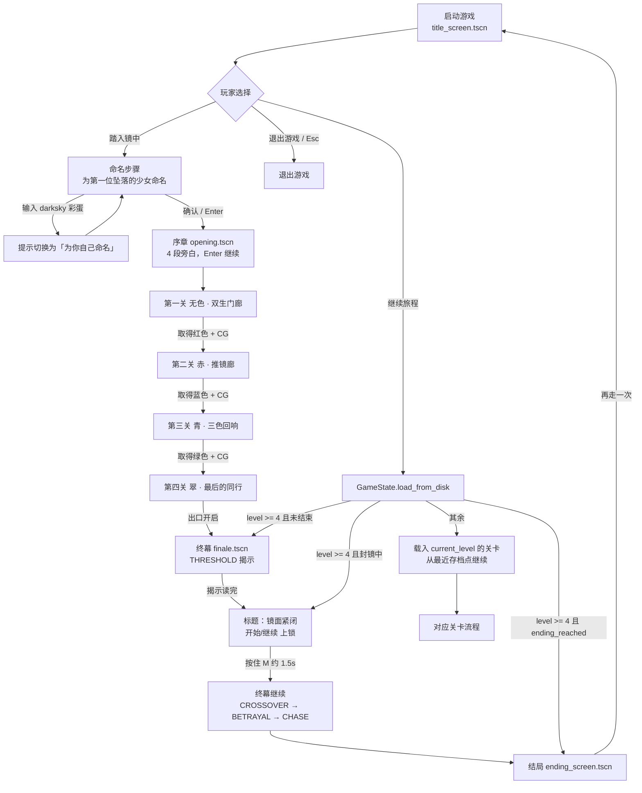
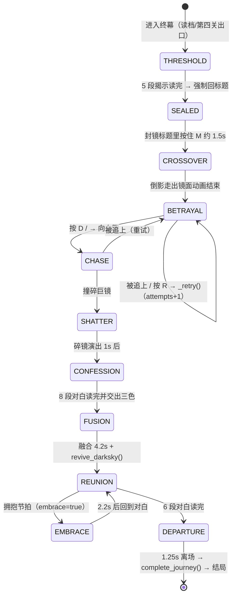
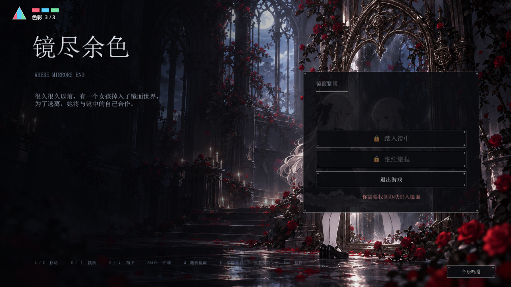
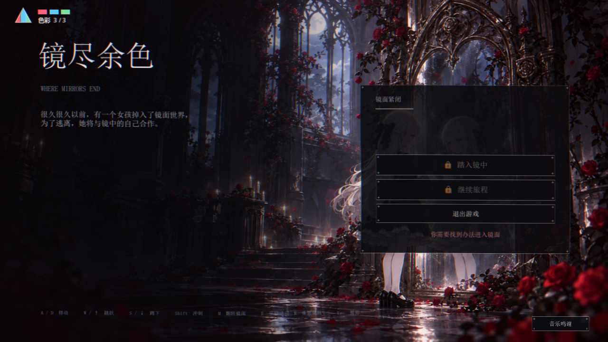

# 游戏流程总览

> 说明：本文按「玩家从启动到通关」的顺序整理完整流程，包含分支、存档、失败重试与终幕相位。所有阶段都标注了实现位置（`文件:行号`），与当前代码一致（2026-10-25）。
>
> 相关文档：[框架说明](framework.md)、[剧情稿](story.md)、[README](../README.md)。

---

## 1. 总流程图

- 只有「继续旅程」走 `load_from_disk()` 分支：`title_screen.gd:193-203`。
- 揭示读完后不会直接进追逐：镜面封闭，玩家被强制送回标题，两个入口上锁；按住 M 充满后回到终幕的 CROSSOVER 继续。
- 「P」调试跳关只在 debug build 生效（`gameplay.gd:108-121`），不属于正常流程。

---

## 2. 阶段时间线

| # | 阶段 | 玩家操作 | 系统行为 | 存档 / 音乐 |
| --- | --- | --- | --- | --- |
| 1 | 开始界面 `title_screen.tscn` | 踏入镜中 / 继续旅程 / 退出游戏；Esc 退出 | 首屏隐藏姓名框；进入命名步骤后确认才 `begin_game()` 并切序章（`title_screen.gd:183-191`） | 有存档时「继续旅程」可见；音乐 explore |
| 2 | 命名（彩蛋） | 输入名字（可留空＝「无名」） | 默认提示「为第一位坠落的少女命名」；输入 `darksky`（忽略大小写/首尾空格）时提示改为「为你自己命名」，重新输入即恢复（`title_screen.gd:176-182`） | 不写档（`begin_game()` 会先清档） |
| 3 | 序章 `opening.tscn` | Enter / 左键逐段推进 4 段旁白 | 禁用镜像输入、吞掉切场景残余输入，淡出进第一关（`opening.gd:24-65,96-116`） | 音乐 explore；无存档 |
| 4 | 四关循环 `gameplay.tscn` | 移动/跳跃/推镜/穿镜/翻转等（见 §3） | `LevelBuilder.build()` 程序化建关 → 解谜 → 开出口 → 收集颜色或进入下一关 | 存档点/收集/过关写 `user://mirror_save.cfg` |
| 5 | 颜色 CG `collection_cg.gd` | 最短 1.8s 后 Enter / 左键继续 | 暂停整棵树、显示对应颜色 CG；确认后 `advance_level()` → 重载下一关（`gameplay.gd:80-106`） | 颜色在 CG 前已写档；中断后继续会重看 CG |
| 6 | 终幕 `finale.tscn` | 读对白、被追逐时向右跑、Shift 冲刺 | 10 相位演出（见 §4），期间可 Esc 暂停/保存并返回标题 | 赠色/复活/离开各阶段写档 |
| 6.5 | 封镜（标题） | 强制回到开始界面；按住 M 约 1.5s | 「踏入镜中 / 继续旅程」上锁 + 浅红提示「你需要找到办法进入镜面」；按住 M 时画面出现克制的抖动与偏红异象，充满后重开镜面 | 写 `mirror_sealed`；重开后写 `revelation_done`；音乐 explore |
| 7 | 结局 `ending_screen.tscn` | 「再走一次」 | 显示主角名字与结局文案，回开始界面（`ending_screen.gd:14-23`） | 音乐 reunion |

---

## 3. 四关流程

每关统一结构：**建关 → 机关解谜（开对应门）→ 走向颜色碎片/出口 → 触发 CG 或下一关**。关卡数据在 `GameState.LEVELS`（`game_state.gd:16-81`），结构由 `level_builder.gd` 的 `match index` 生成（`:25-78`）。

| 关卡 | 目标与机关 | 门 / 存档点 | 收尾 |
| --- | --- | --- | --- |
| 0 无色 · 双生门廊 | 三段「双板接力」教学：先越过踏板再折返，本体与影子分别压住对应踏板；会用到 M 翻转相位 | 门 x=720 / 1190 / 1660；存档点 x=270 / 1240 | 取得**红色** → 红色 CG → 第二关 |
| 1 赤 · 推镜廊 | 双板开栅门 → 推动立镜、按两次刻度校准，E 从立镜穿到镜像另一侧（去程 + 回程） | 门 x=690 / 1390 / 1660；存档点 x=740 / 1300 | 取得**蓝色** → 蓝色 CG → 第三关 |
| 2 青 · 三色回响 | 影子依次踩上/下/上三枚封印 → 推镜避光、E 带影子同渡 → M 转动最近反射镜，让红绿蓝三束光同时抵达接收器 → 出口双板 | 光路门 x=1510、出口门 x=1660；存档 x=270 | 取得**绿色** → 绿色 CG → 第四关 |
| 3 翠 · 最后的同行 | 双板同行 → 影子开光闸与共同穿镜 → 接通三色 → 回地面折返共同压住出口双板 | 出口在 x=1740（无颜色、无 CG） | 出口触发 → 终幕 |

- **颜色进度**：`collected_mask` 位 0/1/2 = 红/蓝/绿；HUD 左上棱镜最多 3/3。第 4 关只有出口，不增加第四色。
- **光路进度**：独立于颜色，`light_channels` 3 bit 全亮才开光路门；被立镜遮断会重新锁定。
- **失败与重试**：R 重建当前房间（保留已过关流程外的颜色/世界进度）；掉出场景或触发重生会回到最近存档点并恢复机关阶段；追逐中被追上回到 BETRAYAL 重试，已收集颜色保留。
- **中途退出**：Esc → 暂停菜单「保存并返回标题」写档后回开始界面；直接关窗口也会自动写档。继续旅程从**当前世界最近的存档点**恢复（不保存像素级位置，避免复活在关闭的门后）。

---

## 4. 终幕相位流程

揭示读完后会先触发**封镜**：强制回标题 → 两个入口上锁（浅红提示）→ 按住 M 充满 → 镜面重开并回到 CROSSOVER。

| 相位 | 内容 | 关键实现 |
| --- | --- | --- |
| THRESHOLD | 镜门只回应主角，她的手穿过光；旧字与「不算活着的人」揭示 | `REVELATION_BEATS`（`finale.gd:38-44`）、`_advance_dialogue()` |
| SEALED | 揭示读完 → 写 `mirror_sealed` 并强制回标题；两个入口上锁，浅红提示「你需要找到办法进入镜面」，按住 M 1.5s 的抖动/偏红异象后重开 | `finale.gd:338-383`、`title_screen.gd:59-132`、`shaders/mirror_hollow.gdshader` |
| CROSSOVER | 倒影走出镜面，边界消失的 1.3s 过场 | `_draw()` 的 `Phase.CROSSOVER` 分支（`finale.gd:264-275`）、`_begin_crossover()`（`:369-374`） |
| BETRAYAL | 「这一次，我不想再做留下的那个人。」→ 进入追逐准备 | `finale.gd:276-281` |
| CHASE | 影子追击；向右跑向巨镜，被追上即重试 | `finale.gd:279-285,376-402` |
| SHATTER | 巨镜碎裂、镜头震动、闪光，1s 后进忏悔 | `finale.gd:286-291,405-415` |
| CONFESSION | 镜背旧字 + 8 段对白；最后一句确认「把三色交给她」 | `CONFESSION_BEATS`、`_advance_confession()`（`:417-462`） |
| FUSION | 赠色融合 4.2s，调用 `revive_darksky()` 恢复她的身体 | `finale.gd:465-484` |
| REUNION | 6 段重逢对白，中途触发拥抱；最后一句揭晓真名「darksky」 | `REUNION_BEATS`、`_show_reunion()`（`:486-526`） |
| EMBRACE | 拥抱 CG 与动作 2.2s，再回到对白 | `_start_embrace()`（`:528-543`） |
| DEPARTURE | 两人牵手走出镜面，淡出后 `complete_journey()` 切结局 | `_leave_mirror()`（`:545-564`） |

封镜实机画面：

**读档重入规则**（`finale.gd:77-107`）：

| 已保存状态 | 进入终幕时的位置 |
| --- | --- |
| 封镜中（`mirror_sealed`） | 不直接进入终幕：标题界面两个入口上锁，按住 M 重开后再进入 |
| 揭示已读、未赠色（`revelation_done`） | 直接进入 CROSSOVER（不再重读揭示） |
| 未读揭示 | 从头播放揭示对白（THRESHOLD） |
| 已赠色但未复活（`has_offered_colors() && !darksky_revived`） | 直接进入 FUSION（从融合中段继续） |
| 已复活未离开（`darksky_revived`） | 直接进入 REUNION（重逢对白） |
| `ending_reached` | 不再进终幕，「继续旅程」直接到结局画面 |

**音乐切换**（`music_director.gd:86-106`）：终幕 CHASE / 重试后的 BETRAYAL 用 chase；FUSION / REUNION / EMBRACE / DEPARTURE 用 reunion；SHATTER 静音；其余用 explore。

---

## 5. 存档与恢复

- **存档位置**：`user://mirror_save.cfg`，ConfigFile，第 8 版（`game_state.gd:11-12`）。
- **写入时机**：
  1. 触碰存档点：`save_checkpoint()`，同时记录当前关卡的机关阶段 `stage`（`game_state.gd:165`、`checkpoint.gd`）。
  2. 每关取得颜色：先写档再播 CG，避免中途退出丢色（`gameplay.gd:80-106`）。
  3. 过关：`advance_level()` 写当前世界（`game_state.gd:154`）。
  4. 终幕：赠色、复活、结局分别写 `offered_mask` / `darksky_revived` / `ending_reached`。
  5. 封镜/重入：揭示读完 `seal_mirror()` 写 `mirror_sealed=true`；按住 M 重开 `open_mirror()` 写 `mirror_sealed=false, revelation_done=true`（`game_state.gd:253-270`）。
  6. 主动退出：暂停菜单 `persist_run()`；窗口关闭 `_on_close_requested()`（仅 gameplay/finale 场景）。
- **继续旅程分支**（`title_screen.gd:193-203`）：封镜中 → 回到上锁的标题界面（不直接进终幕）；否则 `is_finale_pending()` → 终幕；`is_game_complete()` → 结局；否则载入 `current_level`。
- **CG 中断恢复**：读档时若 `current_level < 3` 且颜色已保存，会重放该颜色的 CG，确认后进入下一关（`gameplay.gd:75-78`）。
- **重生**：回到本关初始/最近存档点，清空穿镜、影子封印与光路状态；已收集颜色与世界进度保留。

---

## 6. 分支汇总

| 分支 | 触发 | 结果 |
| --- | --- | --- |
| 新游戏 | 开始界面「踏入镜中」→ 命名确认 | 清档 → 序章 → 第一关 |
| 彩蛋 | 命名时输入 `darksky` | 提示改为「为你自己命名」，其余流程不变 |
| 继续旅程 | 开始界面「继续旅程」 | 按存档分支进入终幕 / 结局 / 对应关卡；封镜中则回到上锁的开始界面 |
| 封镜 | 终幕揭示读完 | 强制回标题；「踏入镜中 / 继续旅程」上锁，显示浅红提示「你需要找到办法进入镜面」 |
| 重开镜面 | 封镜时按住 M 约 1.5s | 画面出现克制的抖动/偏红异象；充满后回终幕 CROSSOVER 继续 |
| 中途退出 | 游戏内 Esc →「保存并返回标题」/ 关闭窗口 | 写档后回开始界面 / 直接退出；下次从最近存档点继续 |
| 暂停 | Esc | 继续游戏；与拾色 CG 的暂停互不抢占 |
| 重试 | R（关卡内）/ 追逐被追上 | 重建房间 / 回到 BETRAYAL 重试；颜色保留 |
| 调试跳关 | P（仅 debug） | 直接获得本关颜色（走真实 CG/存档）；终幕内 P 直接碎镜跳后半段 |
| 结局后 | 结局画面「再走一次」 | 回开始界面（存档保留） |

---

## 7. 关键实现文件

| 流程环节 | 文件 |
| --- | --- |
| 开始界面 / 命名 / 彩蛋 / 封镜 / 继续 / 退出 | `scripts/title_screen.gd`、`scenes/ui/title_screen.tscn`、`shaders/mirror_hollow.gdshader` |
| 序章旁白 | `scripts/opening.gd`、`scenes/opening/opening.tscn` |
| 关卡总控 / 收集 / CG / 暂停 | `scripts/gameplay.gd`、`scripts/collection_cg.gd`、`scripts/pause_menu.gd` |
| 四关生成与机关 | `scripts/level_builder.gd`、`scripts/room_puzzle.gd`、`scripts/prism_circuit.gd` |
| 颜色 / 世界 / 存档 | `scripts/game_state.gd`、`scripts/checkpoint.gd` |
| 终幕 10 相位 | `scripts/finale.gd`、`scripts/final_mirror.gd`、`scripts/chase_backdrop.gd` |
| 结局 | `scripts/ending_screen.gd`、`scenes/ui/ending_screen.tscn` |
| 音乐 / 音效 | `scripts/music_director.gd`、`scripts/sound_effects.gd` |

---

## 8. 测试对应关系

| 测试 | 覆盖的流程 |
| --- | --- |
| `tests/mirror_mechanics.gd` | 开始界面两步命名 → 序章 → 四关解谜/收集/CG/存档迁移 → 终幕揭示 → 封镜/按住 M 重入 → 追逐与赠色 → 结局，以及各机关细节 |
| `tests/ui_flow.gd` | 开始界面退出入口、命名彩蛋提示、Esc 暂停/恢复、保存并返回标题、继续旅程、关窗自动保存 |
| `tests/music_playback.gd` | 各场景/终幕相位的选曲、交叉淡化、暂停续播、碎镜让位 |
| `tests/audio_mix.gd` | 六段音效的发声、总线音量与叠加上限 |
